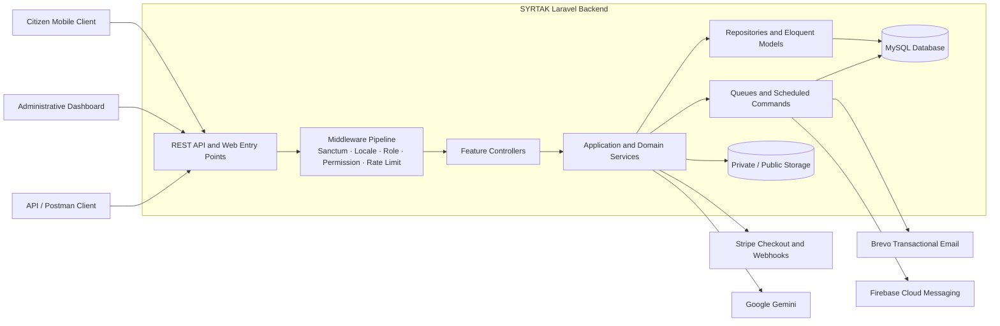
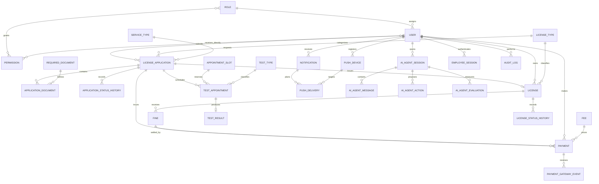

<p align="center">
  
</p>

<h1 align="center">SYRTAK — Digital License Management System</h1>

<p align="center">
  <strong>A secure, API-first platform that digitizes the complete driving-license journey—from citizen onboarding and document review to payments, testing, issuance, verification, and renewal.</strong>
</p>

<p align="center">
  <a href="https://www.php.net/"></a>
  <a href="https://laravel.com/"></a>
  <a href="https://www.mysql.com/"></a>
  <a href="https://www.docker.com/"></a>
  <a href="#license"></a>
</p>

> [!IMPORTANT]
> SYRTAK is an academic  project and is not affiliated with, endorsed by, or operated by any government authority. All public deployments must use synthetic demo data and non-government domains.

## Table of Contents

- [Executive Summary](#executive-summary)
- [Project at a Glance](#project-at-a-glance)
- [System Architecture and Design](#system-architecture-and-design)
- [Database Design and Data Flow](#database-design-and-data-flow)
- [Core Features and Modules](#core-features-and-modules)
- [Technology Stack](#technology-stack)
- [API Documentation](#api-documentation)
- [Local Setup and Installation](#local-setup-and-installation)
- [Docker Setup](#docker-setup)
- [Configuration and Integrations](#configuration-and-integrations)
- [Testing and Quality](#testing-and-quality)
- [Security and Reliability](#security-and-reliability)
- [Scheduled Operations](#scheduled-operations)
- [Role and Acknowledgments](#role-and-acknowledgments)
- [Academic Use and License](#academic-use-and-license)

## Executive Summary

Driving-license services are often distributed across disconnected manual processes: identity verification, document collection, fee payment, appointment scheduling, test-result recording, license issuance, and violation management. This fragmentation increases processing time, limits traceability, and makes it difficult for citizens and employees to understand the current state of a request.

**SYRTAK** centralizes that lifecycle behind a bilingual REST API. Citizens can create and track license applications, upload required documents, pay application fees and fines, reserve test appointments, receive status notifications, and access verifiable digital license credentials. Authorized employees use permission-scoped dashboard APIs to review profiles and documents, manage operational catalogs, record test results, issue licenses, administer fines, monitor sessions, and produce reports.

The platform is designed around four core values:

- **End-to-end traceability:** application and license status histories, persisted operational events, and audit records connect every important state change to its actor.
- **Security by workflow:** authentication, profile approval, user-type separation, granular permissions, rate limits, and explicit AI-action confirmation guard sensitive operations.
- **Operational resilience:** database transactions, row-level locking, idempotent payment-event processing, reconciliation commands, queues, and scheduled maintenance protect critical workflows.
- **Integration readiness:** the backend supports Flutter and web clients while integrating with Stripe, Gemini, Brevo, Firebase Cloud Messaging, and pluggable storage/queue infrastructure.

## Project at a Glance

| Item | Details |
| --- | --- |
| **Project name** | SYRTAK — Digital License Management System (DLMS) |
| **Problem domain** | Digital management of driving-license applications, citizen documents, payments, tests, licenses, fines, and administrative operations |
| **Repository scope** | Laravel backend REST API, Blade-based payment return pages, printable digital credentials, and a local developer testing dashboard |
| **Architecture** | API-first layered modular monolith, organized by business capability |
| **Primary actors** | Citizen, dashboard employee, specialized reviewer/operator, administrator, and root super administrator |
| **Localization** | Arabic-first with English API localization and `Accept-Language` negotiation |
| **My role** | **System Architect & Technical Lead** — system architecture, database modeling, API design, and technical supervision |

The mobile citizen application and production administrative frontend are API consumers and are not included in this backend repository.

## System Architecture and Design

### High-Level Architecture



### Architectural Style

SYRTAK is a **modular monolith with layered feature modules**. It keeps one deployable Laravel application and one transactional database while dividing the codebase into bounded business capabilities under [`app/Modules`](app/Modules). This design retains the consistency and operational simplicity of a monolith while creating clear seams for ownership, testing, and future extraction.

The primary request flow is:

```text
Route → Middleware → Form Request → Controller → Service → Repository/Eloquent
      → Resource/Presenter → Standardized JSON Response
```

Cross-cutting behavior—authentication, authorization, localization, exception rendering, audit logging, rate limiting, session tracking, queues, and notifications—is kept outside controller actions wherever practical.

### Key Patterns and Engineering Practices

| Pattern / Practice | How it is used |
| --- | --- |
| **Feature-based modularity** | Auth, applications, appointments, payments, licenses, AI, dashboard operations, and other capabilities live in separate modules. |
| **Service Layer** | Business rules and state transitions are implemented in dedicated services instead of controllers. |
| **Repository Pattern** | Persistence-focused modules wrap common Eloquent access in repositories for applications, appointments, authentication, licenses, fines, notifications, devices, push delivery, and audit logs. |
| **Form Request validation** | Input validation and authorization are represented by specialized request classes, including the extensive dashboard command surface. |
| **API Resources / Presenters** | Citizen and employee payloads are shaped independently of persistence models. |
| **State modeling with enums** | Application, document, appointment, test, payment, fine, license, profile, notification, OTP, session, and push-delivery states use PHP enums. |
| **Transactional workflows** | Multi-entity mutations use database transactions; contention-sensitive booking, payment, and lifecycle flows use row locks. |
| **Provider strategy** | Payment behavior is selected through a provider manager with mock and Stripe implementations. |
| **Idempotent integration handling** | Stripe gateway events and push-delivery records use stable identifiers and persisted processing states. |
| **Middleware authorization pipeline** | Sanctum authentication is followed by citizen/dashboard separation, profile approval, permission checks, super-admin guards, and employee-session tracking. |
| **Centralized API exceptions** | Validation, authentication, authorization, throttling, missing-resource, and server errors are rendered as consistent JSON responses. |
| **Asynchronous delivery** | OTP email and push notification delivery run through Laravel queues. |

### Repository Structure

```text
app/
├── Console/Commands/       # Reconciliation, lifecycle, RBAC, Firebase, and session commands
├── Enums/                  # Domain state definitions
├── Exceptions/             # API-aware exception types
├── Http/
│   ├── Controllers/Dev/    # Local developer workflow dashboard
│   └── Middleware/         # Authentication, authorization, locale, and session pipeline
├── Jobs/                   # Queued OTP and push delivery
├── Models/                 # Core Eloquent domain models
├── Modules/                # Business capability modules
├── Services/               # Shared mail and audit services
├── Support/                # Localization, rate limiting, TLS, clocks, and shared helpers
└── Traits/                 # Standard API response helpers

database/
├── factories/
├── migrations/             # Relational schema and lifecycle extensions
└── seeders/                # Catalog, bootstrap, demo, and lifecycle datasets

routes/                     # API, web, and scheduled command registration
config/                     # Framework and domain integration configuration
resources/                  # Arabic/English translations, emails, cards, and utility views
postman/                    # Canonical Postman collection and local environment
docker/                     # Nginx, PHP, Supervisor, and container entrypoint configuration
tests/                      # Feature, integration, concurrency, security, and unit tests
```

## Database Design and Data Flow

The schema uses normalized relational entities, explicit foreign keys, unique business identifiers, soft deletion where recovery matters, and indexes aligned with common ownership/status queries. The following diagram intentionally focuses on the main operational relationships; supporting catalog, history, token, and integration tables extend these aggregates.



### Principal Entity Groups

| Aggregate | Key entities | Responsibility |
| --- | --- | --- |
| **Identity and access** | `users`, `roles`, `permissions`, `permission_role`, `permission_user`, `personal_access_tokens`, `employee_sessions` | Citizen/employee identities, RBAC, direct grants, tokens, and administrative session governance |
| **Application lifecycle** | `license_applications`, `application_documents`, `application_status_histories` | Service request ownership, required evidence, review decisions, and state history |
| **Service catalog** | `license_types`, `service_types`, `required_documents`, `fees`, `test_types` | Configurable rules and pricing for new, renewal, replacement, and unblock services |
| **Testing and appointments** | `appointment_centers`, `appointment_slots`, `test_appointments`, `test_results` | Capacity-aware booking, rescheduling, cancellation, attempts, and recorded outcomes |
| **Payments and fines** | `payments`, `payment_gateway_events`, `fines` | Application-fee and fine-payment lifecycles, Stripe references, reconciliation, and webhook idempotency |
| **License credential** | `licenses`, `license_status_histories` | Issuance, expiry, replacement chains, block/unblock history, printing, and public verification tokens |
| **Communication** | `notifications`, `push_devices`, `push_deliveries`, `otps`, `faqs`, `contact_messages` | Localized notifications, delivery tracking, identity verification, and public content |
| **AI assistant** | `ai_agent_sessions`, `ai_agent_messages`, `ai_agent_actions`, `ai_agent_evaluations` | Conversation history, pending actions, explicit confirmation, execution results, and quality telemetry |
| **Auditability** | `audit_logs` and lifecycle history tables | Actor, entity, old/new values, source IP, user agent, and business-state traceability |

### Main License Workflow


The exact transition path depends on the selected service and license type. Renewal, lost/damaged replacement, and unblock requests reuse the application lifecycle while applying service-specific eligibility and related-license rules.

## Core Features and Modules

| Module | Responsibilities |
| --- | --- |
| **Auth** | Citizen registration, email OTP verification, login/logout, password recovery, profile completion, profile updates, and password changes |
| **Applications** | License/service catalogs, application creation and ownership, eligibility validation, document requirements, uploads, submission, and status history |
| **Appointments** | Available-test resolution, appointment centers and slots, capacity-safe booking, rescheduling, cancellation, and progression to the next required test |
| **Tests** | Citizen result history and authorized employee recording of practical/theoretical test outcomes |
| **Payments** | Fee discovery, payment initiation, mock confirmation, Stripe Checkout, webhook processing, payment status polling, fine payments, history, and reconciliation |
| **Licenses** | Issuance eligibility, digital-card rendering, PDF generation, QR verification, renewal, replacement, expiration, printing, and block/unblock lifecycle |
| **Fines** | Citizen fine visibility, administrative creation/update, payment integration, status transitions, and links to affected licenses |
| **Notifications** | Localized in-app notifications, unread counters, read state, event keys, push planning, and delivery retries |
| **Devices / Push / Firebase** | Device-token registration and rotation, Firebase OAuth, FCM HTTP v1 delivery, retry policy, and invalid-token cleanup |
| **AI Agent** | Gemini-assisted bilingual conversation, deterministic intent safeguards, slot filling, application selection, document flows, appointment options, and confirm-before-execute actions |
| **Dashboard** | Operational overview, applications, citizens, documents, payments, appointments, tests, licenses, fees, catalogs, employees, roles, reports, and session administration |
| **Admin** | Permission-scoped profile/document review, test-result recording, license issuance, fines, audit logs, and legacy focused administration endpoints |
| **Audit Logs** | Queryable actor/entity event history with before/after state snapshots |
| **Reports** | Dashboard summaries and filtered application, test, appointment, license, fine, and employee reports |
| **Settings** | Citizen language/theme preferences and password management |
| **Content** | Localized FAQs, privacy content, contact information, and contact-message intake/management |

### Administrative Access Model

- **Citizens** access only citizen-owned resources and must have an approved profile for protected service mutations.
- **Dashboard employees** require the `access_dashboard` capability and are constrained by module-level permissions.
- **Specialized roles** provide least-privilege baselines for profile/document review, tests, licensing, fines, payments, reports, settings, and audit work.
- **Super administrators** manage protected roles, permissions, direct grants, employee access, and session revocation.
- **Root super administrators** receive additional protection around high-risk employee-session governance operations.

## Technology Stack

| Area | Technologies |
| --- | --- |
| **Runtime** | PHP 8.4 |
| **Backend framework** | Laravel 12 |
| **Authentication** | Laravel Sanctum 4, bearer tokens, email OTP |
| **Database** | MySQL 8 for the primary environment; SQLite support for lightweight local/test scenarios |
| **Data access** | Eloquent ORM, repositories, migrations, factories, and seeders |
| **Payments** | Stripe PHP SDK 16, Stripe Checkout, signed webhooks, mock provider for local workflows |
| **AI** | Google Gemini structured-response integration with deterministic fallback and action confirmation |
| **Messaging** | Brevo transactional email API, Laravel mail, Firebase Cloud Messaging HTTP v1 |
| **Documents** | mPDF for license PDFs and Endroid QR Code for verifiable credentials |
| **Queues and scheduling** | Laravel database queues, queued jobs, Scheduler, Supervisor |
| **Localization** | Arabic and English language resources with request/user locale resolution |
| **Frontend utilities** | Blade, Tailwind CSS 4, Vite 7, Axios |
| **Web serving** | Nginx, PHP-FPM, Supervisor |
| **Testing** | PHPUnit 11, Laravel testing utilities, Mockery, Faker |
| **Quality tooling** | Laravel Pint, Composer validation, route and configuration inspection |
| **Containerization** | Docker and Docker Compose |
| **API collaboration** | Postman collection and environment |

## API Documentation

### Conventions

- Local base URL: `http://127.0.0.1:8000/api`
- Authentication: `Authorization: Bearer <sanctum-token>`
- Response content: `Accept: application/json`
- Supported language selection: `Accept-Language: ar` or `Accept-Language: en`
- Uploaded documents use `multipart/form-data`; standard requests use JSON.

Most JSON responses follow one of these envelopes:

```json
{
  "success": true,
  "message": "Operation completed successfully.",
  "data": {}
}
```

```json
{
  "success": false,
  "message": "The given data was invalid.",
  "errors": {}
}
```

### Primary Route Groups

| Route group | Authentication | Purpose |
| --- | --- | --- |
| `GET /api/ping` | Public | API health check |
| `/api/auth/*` | Mixed | Registration, OTP verification, login/logout, identity, and password recovery |
| `/api/license-types`, `/api/service-types`, `/api/test-types` | Public | Localized service catalogs |
| `/api/profile/*`, `/api/settings/*` | Sanctum | Profile lifecycle, preferences, and password management |
| `/api/applications/*` | Citizen + Sanctum | Applications, required documents, uploads, fees, payments, appointments, and results |
| `/api/appointments/*`, `/api/appointment-slots` | Citizen + Sanctum | Slot discovery, rescheduling, and cancellation |
| `/api/licenses/*` | Mixed | Citizen license services plus public token-based verification |
| `/api/fines/*`, `/api/payments/*` | Citizen + Sanctum | Fine/application payment initiation, confirmation, status, and history |
| `/api/notifications/*`, `/api/devices/push-token` | Citizen + Sanctum | Notification center and push-device lifecycle |
| `/api/ai-agent/*` | Citizen + Sanctum | Sessions, messages, interactions, uploads, and action confirmation/cancellation |
| `/api/content/*`, `/api/contact-messages` | Public | FAQs, privacy/contact content, and contact-message intake |
| `/api/dashboard/auth/*` | Mixed | Employee login, password recovery, session identity, and logout |
| `/api/dashboard/*` | Dashboard + Sanctum + permissions | Full administrative and reporting surface |
| `/api/admin/*` | Dashboard + Sanctum + permissions | Focused review, result, issuance, fine, audit, and legacy administration operations |
| `POST /api/webhooks/stripe` | Stripe signature | Asynchronous payment completion/failure events |

The route source of truth is [`routes/api.php`](routes/api.php), with module-specific routes under each module's `Routes` directory. To inspect the complete runtime surface:

```bash
php artisan route:list --path=api
```

### Postman

Import both files from [`postman/`](postman):

- [`SYRTAK_Flutter_API.postman_collection.json`](postman/SYRTAK_Flutter_API.postman_collection.json)
- [`SYRTAK_Local.postman_environment.json`](postman/SYRTAK_Local.postman_environment.json)

The collection covers public, citizen, AI-agent, dashboard, and administrative workflows. OpenAPI/Swagger generation is not currently configured; Postman is the maintained executable API reference for this repository.

## Local Setup and Installation

### Prerequisites

- PHP 8.4 with PDO, Mbstring, BCMath, XML, GD, ZIP, Intl, cURL, and OpenSSL support
- Composer 2
- MySQL 8 (recommended) or SQLite for lightweight development
- Node.js compatible with Vite 7 and npm
- Git

External services such as Stripe, Gemini, Brevo, and Firebase are optional for initial local startup. Their dependent features require valid sandbox/development credentials.

### 1. Clone the Repository

```bash
git clone https://github.com/laith886/SYRTAK.git
cd SYRTAK
```

### 2. Install Backend and Frontend Dependencies

```bash
composer install
npm install
```

### 3. Create the Environment File

Linux/macOS:

```bash
cp .env.example .env
```

Windows PowerShell:

```powershell
Copy-Item .env.example .env
```

Set the application identity and generate an encryption key:

```dotenv
APP_NAME=SYRTAK
APP_ENV=local
APP_DEBUG=true
APP_URL=http://127.0.0.1:8000
```

```bash
php artisan key:generate
```

### 4. Configure MySQL

Create an empty UTF-8 database, then update `.env`:

```dotenv
DB_CONNECTION=mysql
DB_HOST=127.0.0.1
DB_PORT=3306
DB_DATABASE=syrtak
DB_USERNAME=root
DB_PASSWORD=your-local-password
```

For a quick SQLite setup, keep `DB_CONNECTION=sqlite` and create the file:

```bash
touch database/database.sqlite
```

PowerShell equivalent:

```powershell
New-Item -ItemType File database/database.sqlite -Force
```

### 5. Run Migrations and Seed Data

```bash
php artisan migrate --seed
```

Seeding behavior is intentionally environment-aware:

- Catalogs, roles, permissions, fees, centers, slots, FAQs, and the bootstrap administrator are seeded in every environment.
- The complete demo dataset is automatically enabled in `local` and `testing` environments.
- Outside local/testing, demo data runs only when `DEMO_SEEDING_ENABLED=true` is explicitly configured.

Use a disposable database for demo seeding. Never run `migrate:fresh` against a production database, and never enable demo seeding in a real production environment.

### 6. Prepare Storage and Assets

```bash
php artisan storage:link
npm run build
```

### 7. Start the Development Stack

The Composer development command starts the API server, queue listener, log viewer, and Vite together:

```bash
composer run dev
```

Alternatively, run only the API and queue worker:

```bash
php artisan serve
php artisan queue:work --queue=push,mail,default --tries=3
```

Useful local URLs:

- Application: `http://127.0.0.1:8000`
- API health: `http://127.0.0.1:8000/api/ping`
- Framework health: `http://127.0.0.1:8000/up`
- Local testing dashboard: `http://127.0.0.1:8000/dev-dashboard`

> [!WARNING]
> The developer dashboard is a local workflow utility. Do not expose it on a public or production deployment.

## Docker Setup

The included Docker stack runs the Laravel application behind Nginx/PHP-FPM with MySQL 8 and phpMyAdmin.

1. Copy `.env.example` to `.env`.
2. Configure the Compose database connection:

```dotenv
DB_CONNECTION=mysql
DB_HOST=mysql
DB_PORT=3306
DB_DATABASE=dlms_backend
DB_USERNAME=dlms_user
DB_PASSWORD=dlms_password
```

3. Build and start the services:

```bash
docker compose up --build -d
docker compose exec app php artisan key:generate
docker compose exec app php artisan migrate --seed
docker compose exec app php artisan storage:link
```

Docker endpoints:

- Application: `http://localhost:8000`
- phpMyAdmin: `http://localhost:8080`
- MySQL from the host: `127.0.0.1:3307`

Useful commands:

```bash
docker compose ps
docker compose logs -f app
docker compose exec app php artisan route:list --path=api
docker compose exec app php artisan test
docker compose down
```

The Compose credentials are local development defaults only. Replace them before using the stack in a shared environment.

## Configuration and Integrations

Keep real credentials in `.env` or a deployment secret manager. Never commit API keys, service-account JSON, webhook secrets, or production database credentials.

| Capability | Main variables | Notes |
| --- | --- | --- |
| **Demo data** | `DEMO_SEEDING_ENABLED` | Explicit opt-in outside local/testing; must remain disabled for real production data |
| **Localization** | `APP_LOCALE`, `APP_FALLBACK_LOCALE`, `BUSINESS_TIMEZONE` | Arabic is the product default; business-date logic uses `Asia/Damascus` by default |
| **OTP email** | `OTP_CHANNEL`, `OTP_EXPIRES_MINUTES`, `OTP_MAX_ATTEMPTS`, `OTP_FIXED_CODE` | Fixed OTP is for local testing only |
| **Brevo** | `BREVO_API_KEY`, `BREVO_SENDER_EMAIL`, `BREVO_SENDER_NAME` | Server-side transactional OTP delivery |
| **Payments** | `PAYMENT_PROVIDER`, `FINE_CURRENCY`, `PAYMENT_STALE_PENDING_MINUTES` | `mock` for local workflows or `stripe` for Checkout/webhooks |
| **Stripe** | `STRIPE_PUBLISHABLE_KEY`, `STRIPE_SECRET_KEY`, `STRIPE_WEBHOOK_SECRET`, `STRIPE_*_URL` | Use test keys locally; webhooks are the authoritative asynchronous completion channel |
| **AI agent** | `AI_PROVIDER`, `GEMINI_API_KEY`, `GEMINI_MODEL`, `AI_AGENT_*` | Gemini runs only on the server; critical actions remain confirmation-gated |
| **Firebase push** | `FIREBASE_PROJECT_ID`, `FIREBASE_CREDENTIALS_BASE64`, `FIREBASE_PUSH_ENABLED` | Requires a running `push` queue worker; Base64 encoding is not encryption |
| **Queues** | `QUEUE_CONNECTION`, `DB_QUEUE_RETRY_AFTER` | Database queues are the default; retry timeout must exceed job/HTTP timeouts |
| **License credentials** | `LICENSE_VALIDITY_YEARS`, `LICENSE_RENEWAL_GRACE_DAYS`, `LICENSE_VERIFICATION_PUBLIC_URL` | Public URL is embedded in generated QR credentials |
| **Employee sessions** | `EMPLOYEE_SESSION_*` | Controls active/idle thresholds, heartbeat, write throttling, and retention |
| **Storage** | `FILESYSTEM_DISK`, `AWS_*` | Local private/public storage or S3-compatible deployment storage |

### Stripe Webhook Development

With Stripe CLI installed and authenticated:

```bash
stripe listen --forward-to http://127.0.0.1:8000/api/webhooks/stripe
```

Copy the generated signing secret to `STRIPE_WEBHOOK_SECRET`, then clear cached configuration:

```bash
php artisan config:clear
```

## Testing and Quality

The test suite contains more than 120 feature and unit test files covering authentication, localization, authorization, AI workflows, document review, application lifecycles, appointments, concurrency, payments, Stripe, fines, licensing, notifications, Firebase, push delivery, dashboard operations, employee sessions, security boundaries, and seed-data integrity.

Run the complete suite:

```bash
composer test
```

Run focused suites while developing:

```bash
php artisan test --filter=AIAgent
php artisan test --filter=Payment
php artisan test --filter=Dashboard
php artisan test tests/Unit
```

Validate formatting and dependencies:

```bash
vendor/bin/pint --test
composer validate --strict
```

Apply Laravel Pint formatting when preparing a change:

```bash
vendor/bin/pint
```

Database-backed feature tests require the test database configured in [`phpunit.xml`](phpunit.xml) to be reachable. Use a dedicated test database—never a development or production database.

## Security and Reliability

Security controls detected in the implementation include:

- Laravel Sanctum bearer-token authentication for citizens and dashboard employees.
- Separate citizen and dashboard authorization boundaries.
- Granular role-based and direct user permissions with protected system roles.
- Root-super-admin guards for high-risk employee-session management operations.
- Email OTP expiration, attempt limits, cleanup, queue delivery, and throttled verification endpoints.
- Profile-approval gating before citizens can perform sensitive service mutations.
- Ownership checks on applications, documents, appointments, payments, fines, licenses, notifications, and AI sessions.
- Centralized API-safe exception rendering without production stack-trace exposure.
- Rate limiting for registration, login, OTP, payments, uploads, mutations, AI interactions, and webhooks.
- Database transactions and row locks around contention-sensitive state changes.
- Stripe signature verification, idempotent gateway-event reservation, status validation, and reconciliation.
- Auditable lifecycle history for applications, licenses, employees, fees, payments, slots, and access-control changes.
- Employee-session heartbeat, last-seen throttling, revocation, expiry reconciliation, and retention controls.
- Queued push delivery with stable delivery keys, leases, backoff, recovery, and token invalidation.
- Private storage for uploaded citizen documents, with license credentials generated server-side.

These controls are part of an academic, production-oriented design; they do not replace a deployment-specific threat model, penetration test, privacy assessment, secret rotation policy, backup plan, or legal review.

## Scheduled Operations

Laravel Scheduler registers the following operational jobs:

| Schedule | Command | Purpose |
| --- | --- | --- |
| Every 30 minutes | `payments:reconcile-pending` | Reconcile stale pending provider payments |
| Daily at 00:15 business time | `licenses:sync-expired` | Transition eligible licenses to expired state |
| Hourly | `employee-sessions:reconcile` | Reconcile employee session lifecycle state |
| Weekly, Sunday at 03:30 | `employee-sessions:prune --dry-run` | Report retention candidates without deleting them |

Run the scheduler locally with:

```bash
php artisan schedule:work
```

## Role and Acknowledgments

### My Role — System Architect & Backend Developer

My responsibilities centered on the system's technical direction and engineering coherence:

- Designed the modular backend architecture and cross-module boundaries.
- Modeled the relational database, domain aggregates, lifecycle histories, and integrity constraints.
- Designed the REST API contracts for citizen, employee, dashboard, and integration workflows.
- Defined authentication, authorization, RBAC, auditability, and critical state-transition strategies.
- Supervised implementation decisions, integration patterns, testing strategy, and technical quality.
- Coordinated the backend contract with mobile/dashboard consumers and external service integrations.

### Team Collaboration

SYRTAK was developed as a collaborative senior/graduation project. The final system reflects coordinated work across backend engineering, client application development, user-interface design, testing, documentation, and project delivery. Architectural leadership provided the shared contracts and technical standards; each contributor's implementation and review work turned those contracts into an integrated system.

## Academic Use and License

This repository is intended to demonstrate senior-level software architecture and engineering practices. All sample identities, credentials, phone numbers, national identifiers, transactions, and government-style content used in a public copy must be synthetic.

### License

The project metadata declares the software under the **MIT License**. Add the root `LICENSE` file to any public distribution so the grant and attribution terms are explicit.

---

<p align="center">
  Built as a graduation project to demonstrate secure API design, lifecycle modeling, integration engineering, and technical leadership.
</p>
